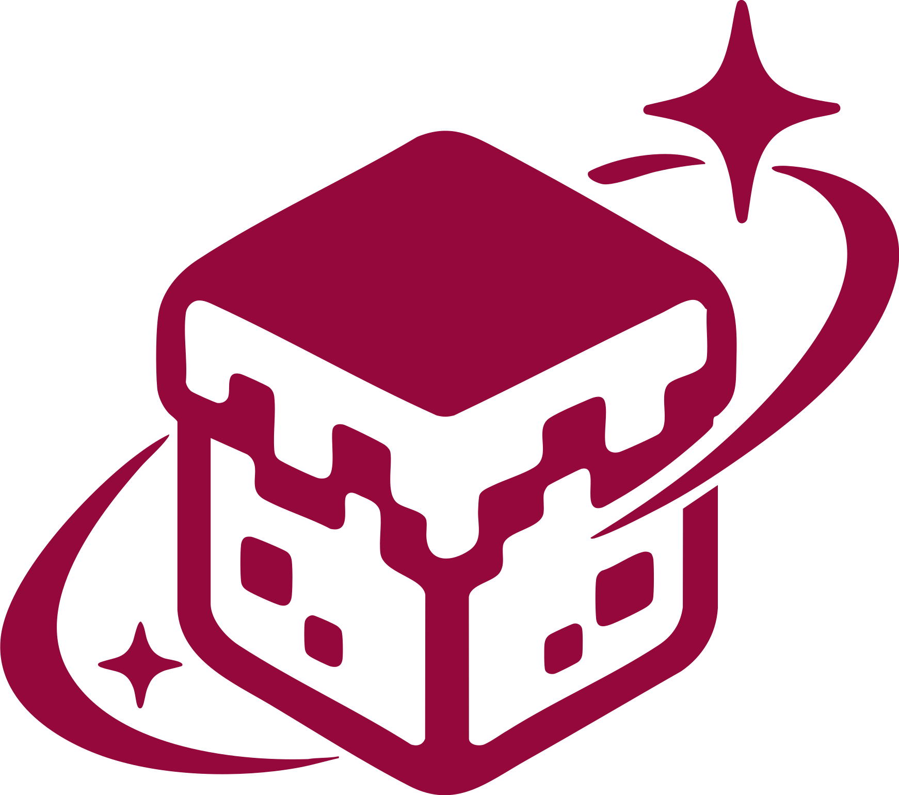

<div align="center">



# SillyCraft

### Собирай модпаки словами, а не руками

Десктоп-приложение, где ты описываешь идею сборки обычным текстом,<br>
а ИИ подбирает моды, шейдеры и ресурспаки под версию Minecraft и загрузчик.

<br>

<a href="https://sangoshi.github.io/SillyCraft/"></a>
<a href="https://github.com/SangoShi/SillyCraft/releases"></a>


</div>

<br>

> [!NOTE]
> Проект в стадии **alpha**. Первая сборка для Windows скоро появится в [Releases](https://github.com/SangoShi/SillyCraft/releases).

<br>

## Как это выглядит

```text
Ты:          Хочу магическое выживание на Fabric 1.21, среднее по размеру, с шейдерами

SillyCraft:  Готовлю план… Botania, Ars Nouveau, Iris Shaders, Sodium и ещё 24 мода.
             Зависимости разрешены, перевод на русский включён. Ставим в Prism Launcher?

Ты:          Да!

SillyCraft:  ✓ Готово! «Магия 1.21» уже в Prism Launcher.
```

Никаких вкладок с вики, ручного поиска совместимых версий и сломанных зависимостей. Просто разговор.

<br>

## Возможности

<table>
<tr>
<td width="50%" valign="top">

### ✦ AI-сборка
Опиши идею обычными словами — ИИ составит план модов и объяснит, зачем нужен каждый. Лишнее можно удалить, своё — добавить.

</td>
<td width="50%" valign="top">

### ✦ Modrinth внутри
Моды, шейдеры, ресурспаки и датапаки — поиск прямо в приложении, без браузера.

</td>
</tr>
<tr>
<td valign="top">

### ✦ Библиотека сборок
Импорт, редактирование списка модов, иконки и описания. Экспорт в `.mrpack`, `.zip` или `.json` в один клик.

</td>
<td valign="top">

### ✦ Авто-перевод
Перевод модов на русский прямо во время сборки.

</td>
</tr>
<tr>
<td valign="top">

### ✦ Установка в лаунчер
Приложение само находит установленные лаунчеры. Один клик — и сборка уже там.

</td>
<td valign="top">

### ✦ 4 загрузчика
Версия загрузчика выбирается вручную или автоматически под версию игры.

</td>
</tr>
</table>

<br>

## Как это работает

| Шаг | | |
|:---:|---|---|
| **1** | **Опиши идею** | Стиль, режим игры и примерное число модов |
| **2** | **Проверь план** | ИИ объяснит выбор — удали лишнее, добавь своё |
| **3** | **Собери** | Скачивание с Modrinth и разрешение зависимостей |
| **4** | **Играй** | Сборка появится в лаунчере. С переводом |

<br>

## Поддержка

<div align="center">

**Загрузчики**


**Лаунчеры**


</div>

<br>

## Установка

1. Скачай последнюю версию из [Releases](https://github.com/SangoShi/SillyCraft/releases).
2. Запусти установщик.
3. Опиши свою первую сборку — и играй.

<br>

## Стек

- **[Tauri](https://tauri.app/)** — лёгкое и быстрое десктоп-приложение
- **[React](https://react.dev/)** — интерфейс
- **[Modrinth API](https://docs.modrinth.com/)** — каталог модов, шейдеров и ресурспаков

<br>

## Структура репозитория

```text
SillyCraft/
├── docs/        # сайт проекта (GitHub Pages)
└── ...          # исходный код приложения
```

<br>

---

<div align="center">

Сделано с 💗 для майнкрафтеров

<sub>SillyCraft — неофициальный проект. Не аффилирован с Mojang Studios или Microsoft.<br>Minecraft — товарный знак Mojang Studios.</sub>

</div>
